<!-- HERO BANNER -->

  

<!-- TYPEWRITER -->

  

 

<!-- TERMINAL DASHBOARD -->

  <table>
    <tr>
      <td align="center" width="45%" valign="top">
        
      </td>
      <td align="center" width="55%" valign="top">
        
      </td>
    </tr>
  </table>

 

<!-- CONTRIBUTION ACTIVITY -->

  <picture>
    <source
      media="(prefers-color-scheme: dark)"
      srcset="https://raw.githubusercontent.com/Ramprasanna2/Ramprasanna2/output/github-contribution-grid-snake-dark.svg"
    />
    <source
      media="(prefers-color-scheme: light)"
      srcset="https://raw.githubusercontent.com/Ramprasanna2/Ramprasanna2/output/github-contribution-grid-snake.svg"
    />
    
  </picture>

 

<!-- ABOUT ME -->
##  About Me

I'm a B.Tech student in **Information Technology** at **Chennai Institute of Technology (CIT)**, passionate about turning complex algorithmic problems into clean, high-performance systems and applying that same rigor to backend engineering and full-stack software.

As a **LeetCode Knight** with over **1,000+ problems solved** and a **2★ CodeChef rating**, competitive programming has honed my computational thinking, algorithmic efficiency, and discipline. Beyond competitive problem solving, I build production-ready backend systems, cryptographic key management tools, and AI-powered applications.

I believe in **rigorous problem solving, continuous daily learning, and building with purpose**—always looking to engineer secure, resilient, and scalable solutions.

---

<!-- EXPERIENCE -->
##  Experience

### Full Stack Developer Intern — SwaaS Systems Private Limited
*Apr 2026 – May 2026*
- Developed a **Centralized Key-Rotation (CKR)** system utilizing **Express.js**, **TypeScript**, and **AES-256-GCM** encryption.
- Built secure RESTful APIs, key versioning workflows, and audit logging to protect sensitive database columns and automate key rotation policies.

---

### Fullstack Developer Intern — VEEREL ENTERPRISES
*Nov 2025 – Dec 2025*
- Engineered robust server-side architecture and REST APIs for an expense-tracking platform using **Node.js**, **Express.js**, and **TypeScript**.
- Designed modular data flows and integrated schema validation to ensure clean transaction records and auditability.

---

### Fullstack Developer Intern — Cyvar Corp
*May 2025 – Jun 2025*
- Developed responsive modern web components using **React**, **Next.js**, **Material UI**, and **Express.js**.
- Enhanced UI responsiveness, optimized client-side state handling, and integrated backend endpoints.

---

<!-- FEATURED PROJECTS -->
##  Featured Projects

### Centralized Key Rotation (CKR) System
A security-first database key-management platform featuring automated cryptographic rotation workflows, AES-256-GCM encryption/decryption, key versioning, integrity verification, column-level security policies, and detailed audit logging.

*Focus: Cryptography • AES-256-GCM • Node.js • Express.js • Supabase • PostgreSQL • Key Management*

---

### Workforce Management System (Workday Clone)
A comprehensive enterprise human resources platform managing organizational hierarchies, shift schedules, attendance workflows, shift swaps, goals, and multi-tier request approvals. Incorporates JWT authentication and role-based access control (Admin, Manager, Employee).

*Focus: Enterprise HR • Role-Based Access Control • Node.js • Express.js • TypeScript • React.js • MongoDB*  

  

---

### AI Chatbot for Alzheimer's Patients
A privacy-focused cognitive assistant using retrieval-augmented generation (RAG) and semantic memory to deliver empathetic, context-aware conversational support. Employs local LLM inference through Ollama and Mistral with vector memory storage.

*Focus: Generative AI • RAG • FastAPI • LangChain • ChromaDB • Ollama • Mistral • Python*

---

### More Web Projects
- [Roll Dice Game](https://github.com/Ramprasanna2/mine-work) — Interactive web game with stateful animations
- [Modern Calculator](https://github.com/Ramprasanna2/calculator) — Responsive calculator with precision operations
- [Task & To-do List](https://github.com/Ramprasanna2/to-do-list) — Clean productivity application with persistent storage

---

<!-- TECH STACK -->
##  Tech Stack

**Languages**  

**Frameworks & Libraries**  

**Databases, Cloud & Vector Stores**  

**Tools & Protocols**  

---

<!-- EDUCATION & CERTIFICATIONS -->
##  Education &amp; Certifications

- 🎓 **B.Tech, Information Technology** — *Chennai Institute of Technology* (2024 – Present)
- 📜 **AWS Certified AI Practitioner** — *AI/ML concepts, LLM architectures, generative AI governance, AWS AI services*
- 📜 **Introduction to MongoDB** — *Document data modeling, aggregation pipelines, indexing, performance*

---

<!-- COMPETITIVE PROGRAMMING & CONTEST STATS (SEPARATE STATS LAST) -->
##  Competitive &amp; Contest Stats

  <table>
    <tr>
      <td align="center" width="50%" valign="top">
        
      </td>
      <td align="center" width="50%" valign="top">
        
      </td>
    </tr>
  </table>

 

<!-- LIVE LEETCODE CONTEST CARD -->

  

 

<!-- GITHUB ACTIVITY & STREAK STATS -->

  <table>
    <tr>
      <td align="center" width="50%" valign="top">
        
      </td>
      <td align="center" width="50%" valign="top">
        
      </td>
    </tr>
  </table>

---

<!-- CONNECT WITH ME -->
##  Connect With Me

